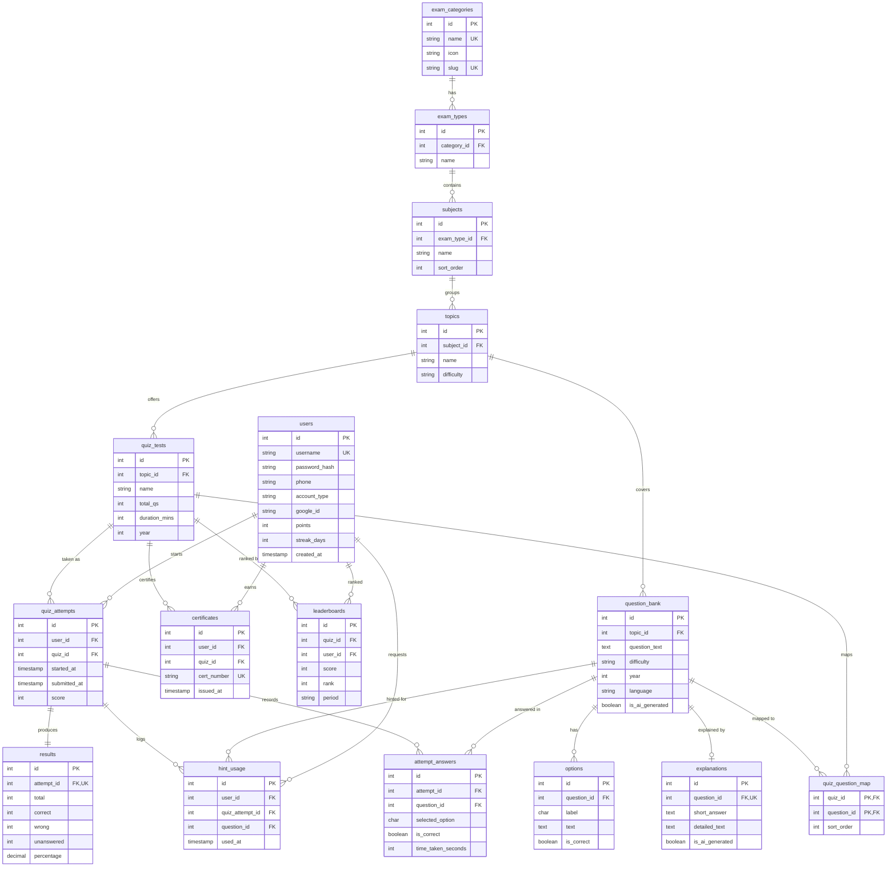

# BANK-101 — Entity Relationship Diagram

This is a standalone extract of the ERD from `EXISTING_ARCHITECTURE_REPORT.md` (§11).
It reflects the **real PostgreSQL schema** (`database/schema.sql`, 16 tables) — the schema the controllers actually use via `pg`. The Prisma/SQLite model (`prisma/schema.prisma`) is omitted because it is orphaned dead code (used only by `seed.ts`, with a different, smaller model that no controller reads). See the main report §10 for the schema contradiction.

## Notes
- **Indexes:** only PKs and explicit `UNIQUE` constraints exist (`users.username`, `exam_categories.name`/`.slug`, `explanations.question_id`, `results.attempt_id`, `certificates.cert_number`). No indexes on any FK column or hot query path.
- **No status/enum columns** on `quiz_attempts` (no `status`, no concurrency guard). `account_type` is free-text with no `CHECK` (so `'Admin'` or arbitrary values can be inserted).
- **Missing entities vs target** (see main report §10): roles, permissions, user_roles, role_permissions, user_sessions, password_resets, email_verifications, audit_logs, exam_sections, exam_subjects, question_tags, question_media, datasets, dataset_versions, dataset_imports, dataset_import_errors, attempt_events, result_details, performance_analytics, subject_performance, study_materials, previous_papers, bookmarks, announcements, notifications, system_settings, application_logs.
- **Two contradictory schemas:** this diagram is the `pg`/PostgreSQL one. The Prisma/SQLite model (`User{id,username,accountType}`, flat `Question{optionA..E}`, `Result`) is disconnected and not depicted.
