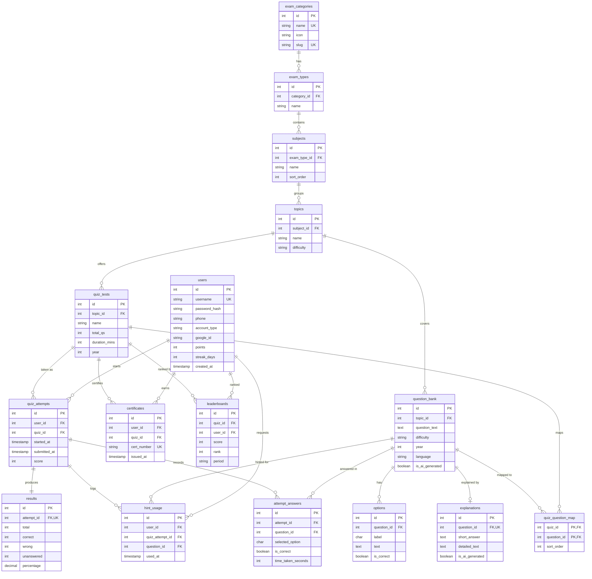

# BANK-101 — Existing Architecture Analysis Report

**Scope:** Read-only reverse-engineering of the `bank-101` competitive-exam-preparation platform located at `d:\(!SanjayASK Projects\BANK-101\bank-101` (the hyphenated `bank-101` folder). All conclusions are cited to source files in that folder. No source files were modified, created, or deleted during this analysis.

**Method:** Every backend source file, every frontend source file, both SQL schema/seed files, the Prisma schema/seed, the build/dependency manifests, and the dataset corpus structure were read directly. No PDFs were opened/OCR'd — the dataset corpus was catalogued structurally only. `.env` and `Logins.txt` were NOT read (flagged as security concerns only).

> Note on scope: A sibling directory `..\BANK101` (no hyphen) exists in the same workspace and appears to be a later, more complete iteration (it contains a `NEXT.md` describing fixes such as removing hardcoded credentials and answer keys, adding tests, and real Google OAuth). It is explicitly OUT OF SCOPE for this report; all analysis below concerns the `bank-101` folder only. It is mentioned only because it confirms the issues below are real and were later addressed elsewhere.

---

## 1. Executive Summary

BANK-101 is an **early-stage, partially-implemented** multi-exam preparation platform. It is a real, runnable monorepo (Node/Express/Prisma/TS backend + React/Vite/TS frontend) but the working surface is narrow and built on significant shortcuts.

**What actually works end-to-end:**
- Username/password registration and login (JWT, bcrypt). Google "OAuth" is **simulated** (invents a random email/id client-side).
- A single subject — **Simplification** (under Bank Exams) — has real questions: 62 questions across 57 quizzes, sourced from a JSON corpus.
- A quiz engine: start attempt → progressive answer save → server-side scoring (correct count / percentage) → result + per-question review with correct answers and explanations.
- Leaderboard, per-user analytics, and certificates (≥80%) — all computed from in-memory mock data.
- An admin "panel" with two features: a stats dashboard and a paste-JSON quiz importer.

**The single most important architectural fact:** The application runs on **two disconnected, contradictory data layers**:
1. **The real path** — raw SQL via the `pg` library (`src/config/db.ts`) against a **PostgreSQL** schema (`database/schema.sql`, 16 tables) with an **in-memory mockDb fallback** that activates whenever Postgres is unreachable. Every controller uses this `query()` dispatcher. This is the schema the controllers actually speak.
2. **The orphaned path** — **Prisma** (`prisma/schema.prisma`) configured for **SQLite** (`file:./dev.db`) with a *different, simpler* model (`User`/`Quiz`/`Question`/`Result`), used **only** by `prisma/seed.ts`. No controller imports `@prisma/client`. The Prisma model does not even match the SQL schema (different tables, missing fields like `password_hash`, `points`, `google_id`).

Net effect: the Prisma layer is dead code, the `.env` `DATABASE_URL` points at Postgres while Prisma points at SQLite, and the seed creates data the controllers cannot read. If Postgres is not running the entire app silently falls back to an in-memory mock populated with 3 demo users — which is almost certainly how it is currently being run.

**Critical security issues (evidence in §15):**
- **Plaintext user credentials are committed** to the frontend source (`frontend/src/data.ts` → `FREE_USERS`/`PRO_USERS`, comment: "From Logins.txt"), alongside a `Logins.txt` at the repo root.
- **The full quiz answer key ships to every client** — `simplification.json` (identical MD5 to the corpus JSON, contains every `correct_option` + `explanation`) is imported at the top of `data.ts` and therefore bundled into the client.
- **A hardcoded login backdoor** — `auth.controller.ts` accepts any password for seeded users whose hash matches a specific bcrypt value.
- **Admin endpoints have zero authentication** — `admin.routes.ts` mounts `/stats` and `/upload-quiz` with no `authMiddleware`; any anonymous caller can read stats or inject quizzes.
- **Client-side-only admin gate** — admin UI is gated by `account_type === 'Admin'`, a value the backend never sets (only `Free`/`Pro` exist), so the admin panel is unreachable through normal flows and trivially bypassable.
- **No authorization model** — no roles, permissions, or server-side access control exists at all.
- Hardcoded JWT secret fallback (`bank101_secret_key_jwt_authentication_2026`) committed in `.env.example` and source.
- Any authenticated user can self-upgrade `Free`→`Pro` (and the frontend exposes this toggle).

**Implementation status summary:** Authentication = Partial; Authorization = Missing; Admin Panel = Partial (2 of ~10 features); User Panel = Partial (quiz engine works; discovery/practice/progress are mock or absent); Examination Engine = Partial (no negative marking, no mark-for-review, no timer enforcement, hardcoded 50-min timer, option-E dropped, no attempt recovery); Dataset Management = Partial (JSON paste only, mock-only writes, no validation/rollback/history); Testing = Missing; Deployment = Missing; Version Control = Missing (no `.git`).

---

## 2. Existing Technology Stack

| Layer | Technology | Version (from manifests) | Evidence |
|---|---|---|---|
| Backend runtime | Node.js + TypeScript | TS `^5.4.5`, target ES2022, CommonJS | `backend/package.json`, `backend/tsconfig.json` |
| Web framework | Express | `^4.19.2` | `backend/package.json`, `src/server.ts` |
| DB client (actual) | `pg` (node-postgres) raw SQL | `^8.11.5` | `backend/package.json`, `src/config/db.ts` |
| ORM (orphaned) | Prisma + `@prisma/client` | `^7.8.0` | `backend/package.json`, `prisma/schema.prisma` (used only by `seed.ts`) |
| Auth | JWT (`jsonwebtoken` `^9.0.2`) + bcrypt (`bcryptjs` `^2.4.3`) | — | `src/modules/auth/auth.controller.ts` |
| Config | `dotenv` `^16.4.5` | — | `src/server.ts`, `src/config/db.ts` |
| CORS | `cors` `^2.8.5` (no config — wide open) | — | `src/server.ts` (`app.use(cors())`) |
| Frontend framework | React | `^19.0.0` (React 19) | `frontend/package.json` |
| Build/dev | Vite | `^6.0.0` | `frontend/package.json`, `vite.config.ts` |
| Language | TypeScript | `^5.2.2` (`strict`, `noUnusedLocals`) | `frontend/tsconfig.json` |
| Styling | Tailwind CSS v4 (`@tailwindcss/vite` `^4.0.0`, CSS-first config via `@import "tailwindcss"`) | — | `frontend/vite.config.ts`, `src/index.css` |
| State management | Zustand | `^4.5.2` | `frontend/src/app/store/store.ts` |
| Icons | Material Symbols Outlined (Google Fonts CDN) + `lucide-react` `^0.379.0` | — | `frontend/index.html`, `frontend/package.json` |
| Animation | `motion` (Framer Motion v12) `^12.23.24` | — | `frontend/package.json` (no usage found in read pages — **likely unused**) |
| Routing lib | `react-router-dom` `^6.22.3` | — | `frontend/package.json` — **UNUSED**: routing is a manual `useState` screen machine (`App.tsx`) |
| Database (intended) | PostgreSQL (per `.env.example` `DATABASE_URL=postgresql://...`) | — | `backend/.env.example` |
| Database (Prisma-declared) | SQLite (`file:./dev.db`) | — | `prisma/schema.prisma` (contradicts the above) |
| HTTP client | Native `fetch` (no axios) | — | `frontend/src/app/store/store.ts` and page components |
| Form validation | None (hand-rolled non-empty checks) | — | `LoginPage.tsx`, controllers |
| Testing | **None** (no vitest/jest/playwright, no test files) | — | §18 |
| Deployment | **None** (no Docker/CI/scripts) | — | §19 |
| Version control | **None** — not a git repository; no `.gitignore` | — | `Test-Path .git` = False |

**Unused/contradictory dependencies:** `react-router-dom` (installed, not imported anywhere), `motion` (installed, no usage found), `lucide-react` (installed, Material Symbols used instead in read files), the entire Prisma toolchain (installed but only `seed.ts` uses it; no controller uses `@prisma/client`).

**Auth method:** stateless JWT (Bearer token in `Authorization` header), 7-day expiry, verified by `auth.middleware.ts`. No refresh tokens, no server-side session store, no logout endpoint (logout is client-side only — removes `localStorage`).

---

## 3. Existing Folder Architecture (Actual)

### `backend/` (Node + Express + TS)
```
backend/
├── .env                      # NOT read (secrets). Exists.
├── .env.example              # PORT, JWT_SECRET (committed weak default), DATABASE_URL (postgres), GOOGLE_CLIENT_ID (mock)
├── package.json              # express, pg, prisma, bcryptjs, jsonwebtoken, cors, dotenv
├── tsconfig.json             # ES2022/strict; include = ["src/**/*"] (prisma/ NOT compiled by build)
├── package-lock.json
├── dist/                     # stale compiled build output (exists)
├── prisma/
│   ├── schema.prisma         # SQLite; models User/Quiz/Question/Result (DOES NOT match SQL schema)
│   ├── seed.ts               # uses PrismaClient; reads DBMS JSON; standalone (no npm script wires it)
│   └── dev.db                # SQLite file
└── src/
    ├── server.ts            # app entry; mounts routes; health; global error handler; CORS wide-open
    ├── config/
    │   └── db.ts            # pg Pool + in-memory mockDb + mockQuery() SQL simulator (the REAL data layer)
    ├── middleware/
    │   └── auth.middleware.ts # JWT verify; AuthenticatedRequest.user
    └── modules/
        ├── auth/
        │   ├── auth.controller.ts  # register, login, googleLogin, updateProfile
        │   └── auth.routes.ts       # /register /login /google-oauth PUT /update
        ├── admin/
        │   └── admin.routes.ts     # /stats /upload-quiz  (NO authMiddleware)
        ├── quizzes/
        │   ├── quiz.controller.ts  # 16 handlers (categories→types→subjects→quizzes→questions→attempts→hints→results→leaderboard→certificates→analytics)
        │   └── quiz.routes.ts      # 16 routes under /api/v1
        └── users/                   # EMPTY directory (no files)
```

### `frontend/` (Vite + React 19 + TS)
```
frontend/
├── index.html               # loads Inter + Material Symbols from Google Fonts CDN
├── package.json             # react 19, vite 6, tailwind 4, zustand, react-router-dom (unused)
├── vite.config.ts           # port 3000; proxy /api -> localhost:5000; alias @->src
├── tsconfig.json            # strict; noEmit; jsx react-jsx; resolveJsonModule (enables JSON import)
├── package-lock.json
├── dist/                    # stale build output (exists)
└── src/
    ├── main.tsx            # ReactDOM root + StrictMode
    ├── App.tsx             # manual useState<Screen> router (NOT react-router); admin vs student branch
    ├── data.ts             # FREE_USERS/PRO_USERS (plaintext creds), HIERARCHY_DATA (static taxonomy), JSON_QUIZZES
    ├── simplification.json  # byte-identical copy of DBMS corpus (answer keys) -> bundled to client
    ├── index.css           # Tailwind v4 @import + custom theme vars + material-symbols settings
    ├── app/store/store.ts  # Zustand "god store": auth + selection + exam engine + results + all fetch calls
    ├── contexts/ThemeContext.tsx  # dark/light toggle, persisted
    ├── components/common/
    │   ├── Header.tsx      # reusable page header with optional back button
    │   ├── Sidebar.tsx     # student nav (Dashboard, Leaderboard, Performance, Certificates)
    │   └── AdminSidebar.tsx# admin nav (Platform Stats, Data Ingestion)
    └── pages/
        ├── auth/LoginPage.tsx            # login + signup + fake Google
        ├── dashboard/DashboardPage.tsx    # uses HIERARCHY_DATA (static) for categories
        ├── exams/ExamTypesPage.tsx        # static (selectedCategory.types)
        ├── subjects/SubjectListPage.tsx   # static (selectedExamType.subjects) + decorative TEST_TYPES
        ├── subjects/TopicListPage.tsx     # static (selectedSubject.topics)
        ├── quiz/QuizListPage.tsx          # API: GET /quizzes/:topic  (first real API call)
        ├── quiz/QuizDetailPage.tsx        # API: GET /quizzes/detail/:id; Start Exam
        ├── quiz/QuizEnginePage.tsx        # exam UI: timer, question grid, options A-D, hint, submit
        ├── quiz/ResultPage.tsx            # scorecard: %, breakdown, review (A-D), explanation
        ├── analytics/AnalyticsPage.tsx    # API: GET /analytics
        ├── analytics/LeaderboardPage.tsx  # API: GET /leaderboard
        ├── certificates/CertificatesPage.tsx # API: GET /certificates; print-to-PDF
        ├── admin/AdminDashboard.tsx       # API: GET /admin/stats (no auth)
        └── admin/AdminUpload.tsx          # API: POST /admin/upload-quiz (pasted JSON)
```

### `database/`
```
database/
├── schema.sql              # authoritative PostgreSQL schema: 16 tables (matches mockDb)
├── seed.sql                # seeds categories, types, subjects, topics, quizzes, 10 questions/options/explanations
├── migrations/             # EMPTY
├── seeds/                  # EMPTY
└── DBMS/                   # raw exam PDF corpus (structural catalog only)
    ├── BANK EXAMS/
    │   └── Simplification/
    │       └── Part 1/
    │           ├── Simplification_Quiz_1.pdf ... Simplification_Quiz_57.pdf  (57 PDFs)
    │           ├── Bundle/   (5 PDFs: Simplifications_PDF_Set_1..5.pdf)
    │           └── Json file/Simplification .json  (37KB; 57 quizzes, 62 questions; the canonical dataset)
    ├── GATE/   (empty)
    ├── JEE/    (empty)
    ├── NEET/   (empty)
    ├── RRB/    (empty)
    ├── SSC/    (empty)
    ├── TET/    (empty)
    ├── TNPSC/  (empty)
    ├── TRB/    (empty)
    └── UPSC/   (empty)
```
**Corpus totals:** 10 category folders, but only **BANK EXAMS** is populated — 62 PDFs + 1 JSON (63 files). The other 9 categories are empty placeholder folders. The JSON is the extracted, machine-readable form of the Simplification quizzes and is the dataset format both `seed.ts` and the admin importer expect.

---

## 4. Authentication Architecture

**Status: Partial** — register and login work; logout, password reset, email verification, and session invalidation are missing.

**Evidence:** `backend/src/modules/auth/auth.controller.ts`, `auth.routes.ts`, `middleware/auth.middleware.ts`; `frontend/src/app/store/store.ts`, `pages/auth/LoginPage.tsx`.

**Flow (register):**
1. Frontend `LoginPage.tsx` `handleSignUp` → store `register(username, password, phone)` → `POST /api/v1/auth/register`.
2. Controller validates `username`/`password` present; checks `SELECT * FROM users WHERE username=$1` (mock returns [] for new names); `bcrypt.genSalt(10)` + `bcrypt.hash`; `INSERT INTO users (...) RETURNING ...` (account_type forced to `'Free'`, points/streak 0); signs JWT (7d) and returns `{token, user}`.
3. Frontend stores `bank101_token` + `bank101_user` in `localStorage`.

**Flow (login):**
1. `LoginPage.tsx` `handleLogin` → store `login` → `POST /api/v1/auth/login`.
2. Controller fetches user by username; `bcrypt.compare(password, password_hash)`.
   - **Backdoor:** if `bcrypt.compare` throws, it falls back to `isMatch = password === user.password_hash || user.password_hash.startsWith('$2a$10$gJ6c4b2pA8b0y.6d2.K3U.3U9w9e7d9e7d9e7d9e7d9e7d9e7d9e')`. The 3 seeded mock users all share that exact hash prefix, so **any password logs them in**. (`auth.controller.ts` lines within `login`.)
3. On success, signs JWT `{id, username, account_type}` and returns the user profile.

**JWT:** `jsonwebtoken.sign(..., secret, {expiresIn:'7d'})`. Secret = `process.env.JWT_SECRET || 'bank101_secret_key_jwt_authentication_2026'` — a hardcoded fallback committed in `.env.example` and used in both the controller and the middleware. No refresh token. `authMiddleware` verifies Bearer token and sets `req.user = {id, username, account_type}`; returns 401 (missing) or 403 (invalid/expired).

**Google "OAuth":** `POST /api/v1/auth/google-oauth` exists server-side (`googleLogin`), but the frontend `handleGoogleSignIn` (`LoginPage.tsx`) **invents a random email/name/googleId** (`candidate_<rand>@gmail.com`, `'g_'+rand`) and calls the endpoint — there is no real Google Identity integration. Server upserts by `google_id`/`username`, creates a random placeholder password. `.env.example` `GOOGLE_CLIENT_ID=mock_google_client_id`.

**Profile update:** `PUT /api/v1/auth/update` (auth-protected) — `updateProfile` uses `COALESCE` to update `points`, `streak_days`, `account_type` for the JWT user. Because it trusts the body's `account_type`, **any user can self-set `account_type`** (the frontend `updateAccountType` exposes a Free/Pro toggle) — privilege escalation.

**Logout:** client-side only — `store.logout()` removes `localStorage` keys and clears state. **No server logout endpoint exists**, so the JWT remains valid for 7 days after "logout" (no token blacklist/revocation).

**Missing auth features:** logout/session invalidation, forgot-password, reset-password, email verification, refresh-token rotation, rate limiting, account lockout, MFA. Password policy is "non-empty" only (no length/complexity check anywhere).

---

## 5. Authorization Architecture

**Status: Missing.** There is no role or permission system. "Roles" reduce to a single free-text `account_type` column holding `'Free'` or `'Pro'` (a billing tier, not an authorization role). `'Admin'` appears only as a frontend string comparison and is never produced by the backend.

**Evidence:** `schema.sql` (`users.account_type VARCHAR(20) DEFAULT 'Free'`), `auth.controller.ts` (register forces `'Free'`), `auth.middleware.ts` (token carries `account_type`), `App.tsx` (`user.account_type === 'Admin'`).

**Role-permission matrix (actual — all empty):**

| Capability | admin | user (Free) | user (Pro) |
|---|---|---|---|
| Register / login | n/a (no admin role exists) | ✓ | ✓ |
| Attempt quizzes | — | ✓ | ✓ |
| View own results/analytics/certs | — | ✓ | ✓ |
| Use hints | — | 10 per attempt | unlimited |
| Access admin stats / upload quizzes | **NO server gate at all** (endpoints unprotected) | technically callable by anyone | technically callable by anyone |
| Manage users / exams / question bank | — | ✗ (no endpoints exist) | ✗ |
| Self-upgrade account tier | — | ✓ (via `PUT /auth/update`) | ✓ |

**The "admin" role is fictional:** `App.tsx` routes to the admin layout only when `user.account_type === 'Admin'`, but the backend never assigns `'Admin'` — register forces `'Free'`, mock seed users are `Free`/`Pro`. So the admin panel is **unreachable through any normal flow** and the gate is purely client-side (bypassable by editing `localStorage` or directly hitting the unprotected `/admin/*` endpoints).

**Protected APIs:** all `/api/v1/exams|subjects|quizzes|questions|attempts|hints|results|leaderboard|certificates|analytics` routes use `authMiddleware` (valid JWT required). The two `/api/v1/admin/*` routes use **none**. `PUT /api/v1/auth/update` requires a JWT but performs no authorization beyond identity (any user can edit their own tier). There is **no ownership enforcement on `attempts/answer` or `attempts/submit`** beyond the JWT `user.id` embedded in records; `getResultByAttempt` does verify ownership (`a.user_id = $2`).

**Missing:** roles table, permissions table, role-permission mapping, user-role mapping, server-side access policies, audit logging, any `requireRole`/`requirePermission` middleware.

---

## 6. Admin Panel Architecture

**Status: Partial (2 of the ~10 target admin features).** Only Dashboard stats and Data Ingestion exist; both are shallow and one is dangerous.

**Evidence:** `backend/src/modules/admin/admin.routes.ts`; `frontend/src/pages/admin/AdminDashboard.tsx`, `AdminUpload.tsx`, `components/common/AdminSidebar.tsx`.

**Admin features inventory:**

| Target feature | Status | Evidence / notes |
|---|---|---|
| 01 Dashboard (totals) | **Partial** | `GET /admin/stats` returns `totalUsers/Quizzes/Questions/Attempts` + `recentUsers` (mockDb). Header openly says "from the mock datastore." No active-users, performance, or time-series analytics. |
| 02 User Management | **Missing** | No list/create/edit/deactivate/assign-role endpoints or UI. |
| 03 Exam Category Mgmt | **Missing** | Categories are static seed data only (no CRUD). |
| 04 Exam Management | **Missing** | No exam create/edit/schedule/publish endpoints. Quizzes are only created via the uploader. |
| 05 Question Bank CRUD | **Missing** | No create/edit/delete/archive question endpoints. |
| 06 Dataset Management | **Partial (insecure)** | `POST /admin/upload-quiz` only; pasted-JSON, writes to **mockDb** only (not Postgres), no file upload, no CSV/JSONL, no schema detection, no validation beyond `Array.isArray`, no duplicate detection, no error report, no import history, no rollback. **No auth.** |
| 07 Exam Attempt Mgmt | **Missing** | No admin attempt oversight. |
| 08 Results & Analytics | **Missing** | No admin analytics; the `/analytics` endpoint is per-user only. |
| 09 Content Management | **Missing** | No study materials/notes/papers/announcements. |
| 10 System Settings | **Missing** | No roles/permissions/notifications/audit-log management. |

**Critical:** `admin.routes.ts` mounts both routes with **no `authMiddleware`** — `router.get('/stats', ...)` and `router.post('/upload-quiz', ...)` are callable by any anonymous client. The frontend *sends* a Bearer token, but the backend ignores it (the handler signatures don't even read `req.user`). The importer mutates only the in-memory `mockDb`, so any "ingested" quizzes vanish on server restart and never reach Postgres.

---

## 7. User Panel Architecture

**Status: Partial.** The exam-taking core works; exam discovery is largely a static mock; practice/learning/preparation are absent; progress is mock-derived.

**Student journey trace:**

| Step | Status | Evidence |
|---|---|---|
| Registration | **Existing** | `LoginPage.tsx` signup panel → `register` → `POST /auth/register`. |
| Login | **Existing** | `LoginPage.tsx` → `login`. |
| Dashboard | **Partial** | `DashboardPage.tsx` shows streak/points/tier + category cards. Categories come from **static `HIERARCHY_DATA`**, not the API. "Enroll"/"Masterclass" buttons alert "coming soon." |
| Exam Discovery (categories→types→subjects→topics) | **Mock** | `ExamTypesPage`/`SubjectListPage`/`TopicListPage` all render from the **static** `selectedCategory.types`/`.subjects`/`.topics`. The backend `/exams/categories|types|subjects` endpoints exist but are **not called** by these pages. Only `QuizListPage` calls the real API. |
| Quiz list | **Existing** | `QuizListPage` → `GET /quizzes/:topic` (by topic name). Empty-state steers users to "Simplification." |
| Quiz detail / start | **Existing** | `QuizDetailPage` → `GET /quizzes/detail/:id` then `startExam` (creates attempt + fetches questions). |
| Mock Examination | **Partial** | `QuizEnginePage`: question grid nav, timer (hardcoded 3000s), option select (A–D only), progressive save, hint, submit confirmation. **No** mark-for-review, no instructions screen beyond the detail card, no pause, no attempt recovery on reload. |
| Answer submission | **Existing** | `selectAnswer` → `POST /attempts/answer` (per-question upsert); `submitExam` → `POST /attempts/submit`. |
| Evaluation/Scoring | **Partial** | Server-side scoring = `correct/total*100`. **No negative marking**, no per-question marks config, no section-wise scoring. |
| Results | **Existing** | `ResultPage` reads `examResults` + `reviewItems` (from `GET /results/:attemptId`). 40% pass threshold is **client-side hardcoded**. Review shows A–D only. |
| Progress Tracking | **Partial (mock)** | `AnalyticsPage` → `GET /analytics` (computed from mockDb only). Topic accuracy, weekly progress (last 7). No real time-management or improvement-trend analytics. |
| Certificates | **Existing (fragile)** | `CertificatesPage` → `GET /certificates` (≥80%). Print-to-PDF via a new window. Certificate IDs use `Math.random()` server-side, so the **ID changes every request**. |
| Notifications/Support | **Missing** | No notifications, announcements, or help endpoints/UI. |
| Profile management | **Partial** | No profile page; only the Free/Pro toggle (`updateAccountType`) and the implicit points/streak from submissions. No password-change, no email, no avatar. |

---

## 8. Frontend Architecture

**Evidence:** all files under `frontend/src/`.

**Routing:** **Manual, not router-based.** `App.tsx` keeps `const [screen, setScreen] = useState<Screen>('AUTH')` and conditionally renders one page, passing `setScreen` down as a prop. There are no URL changes, no deep links, no back-button support, no route guards beyond `if (!user || !token) return <LoginPage/>`. `react-router-dom` is installed but **not imported anywhere** (unused dependency). On login, `account_type==='Admin'` branches to the admin layout; else the student layout. The exam room (`EXAM_ROOM`) renders full-screen without the sidebar.

**State management:** a single Zustand **"god store"** (`app/store/store.ts`) holding: auth (`token`,`user`), all navigation selections (`categories`,`examTypes`,`subjects`,`quizzes`, plus selected*), the entire exam engine (`isExamActive`,`activeAttemptId`,`questions`,`currentQuestionIndex`,`answers`,`timeRemaining`,`hintsRemaining`,`hintsUsed`), results (`examResults`,`reviewItems`), and ~15 `fetch`-based action methods. No slicing, no persistence middleware (auth is hand-persisted to `localStorage` in each action). `ThemeContext` is the only other context.

**API integration:** native `fetch` against `/api/v1` (proxied to `:5000` in dev). Every call attaches `Authorization: Bearer ${token}` from the store. There is **no centralized API client** (calls are inline in the store and in some pages — e.g., `QuizListPage`, `QuizDetailPage`, `AdminDashboard`, `AdminUpload`, `AnalyticsPage`, `LeaderboardPage`, `CertificatesPage` each call `fetch` directly). Error handling is `console.error` + silent fall-through (no user-visible error toasts except the login page's `errorMsg`).

**Static data vs API split (important):** The rich 10-category exam taxonomy shown to users is **fake/static** (`HIERARCHY_DATA` in `data.ts` — TNPSC/Bank/SSC/RRB/UPSC/GATE/NEET/TET/TRB/JEE with types/subjects/topics). The backend DB only contains Bank Exams→Simplification. So users see a full catalog but can only actually take Simplification quizzes. `data.ts` also exports `JSON_QUIZZES` (the bundled answer key) and `FREE_USERS`/`PRO_USERS` (plaintext creds) — these last three are **not imported by any component** (dead exports), but `simplification.json` is imported at module top-level so it is bundled regardless.

**Forms/validation:** only the login/signup form exists; validation is hand-rolled "non-empty" checks. No schema library (no zod/yup/react-hook-form). "Forgot password" is an `alert('Contact Admin')`. Google button is a simulated random payload.

**Loading/error states:** ad-hoc per page (`loading` booleans, `animate-pulse` placeholders, empty-state cards). No global error boundary, no toast system, no skeleton component.

**Accessibility:** **unverified / likely poor.** No `aria-*` attributes, no focus management, no `role` usage, custom `<button>` grids without keyboard nav, color contrast not checked, modals (`confirmSubmit`) lack focus-trap/escape handling. Full WCAG compliance would require manual AT testing (not performed here).

**Styling debt:** components use many **non-existent Tailwind shades** — e.g. `bg-slate-850`, `text-blue-450`, `bg-amber-105`, `bg-red-650`, `bg-indigo-850`, `border-slate-205`, `text-amber-755`, `bg-blue-650`. Tailwind v4's default palette uses 50/100/200…/950 increments; there is **no `@theme` block** defining these custom shades in `index.css`. Such classes are silently no-ops (no styles generated), so several intended colors/borders simply do not render. The UI still functions because other valid classes on the same elements apply, but it is cosmetic breakage spread across most pages.

**External runtime dependency:** `index.html` loads **Inter** and **Material Symbols Outlined** from `fonts.googleapis.com` at runtime — the entire icon set depends on a Google Fonts CDN fetch; offline/air-gapped use breaks icons.

---

## 9. Backend Architecture

**Evidence:** `src/server.ts`, `src/config/db.ts`, `src/middleware/auth.middleware.ts`, the three module folders.

**Pattern:** thin route → controller handler → raw SQL via the shared `query()` dispatcher. There is **no service/repository layer** — controllers contain business logic, SQL, and error handling inline. No DTOs, no validators, no transaction helpers.

**`server.ts`:** `dotenv.config()`, `app.use(cors())` (**CORS wide-open, no allow-list**), `express.json()` (**no body-size limit**), mounts `/api/v1/auth`, `/api/v1` (quizzes), `/api/v1/admin`, a `GET /health` check, and a final 4-arg global error handler that returns `{success:false, message}`. No request logging, no helmet, no rate limiter, no compression.

**`config/db.ts` — the dual-mode data layer (core architectural quirk):**
- Creates a `pg.Pool` from `DATABASE_URL`; on startup it runs `SELECT NOW()` and, **on any failure, sets `useMock=true`** and logs a warning. Every subsequent `query()` checks `useMock`; if true (or if a real query throws), it routes to `mockQuery()`.
- `mockQuery()` is a hand-written string-matching SQL simulator over an in-memory `mockDb` object (users, exam_categories, exam_types, subjects, topics, quiz_tests, question_bank, options, explanations, quiz_question_map, quiz_attempts, attempt_answers, hint_usage, results, certificates, leaderboards). It only handles a handful of hardcoded SQL shapes; any unrecognized query returns `{rows:[]}`.
- Consequence: the app "works" with no Postgres running (silent fallback), but data is ephemeral, the mock can't handle arbitrary SQL, and admin ingestion only mutates mockDb (lost on restart). This fallback masks real DB misconfiguration.

**Auth middleware:** JWT verify only; populates `req.user`. No role/permission check helper exists.

**Error handling:** each controller wraps its body in `try/catch` returning `500 {success:false, message: err.message}` — **exception messages leak to clients** (info disclosure). The global handler does the same. No structured error codes, no logging framework (only `console.error`).

**Performance bottlenecks:**
- `getQuestions`, `getResultByAttempt`, and the admin importer run **N+1 queries** (one per question for options/explanations/user-answer). No joins/batching.
- `getAnalytics`/`getCertificates`/`getLeaderboard` read the **entire mockDb into memory** and filter in JS rather than via SQL — fine for mock, non-viable at scale.
- No DB indexes beyond PKs/UNIQUE (see §10); FK columns (`category_id`, `topic_id`, `quiz_id`, `user_id`, `question_id`, `attempt_id`) are unindexed.
- No caching, no pagination (quiz/subject lists return all rows).

**Security (backend):** see §15 — unprotected admin routes, login backdoor, secret fallback, no input validation/sanitization, no rate limiting, no CSRF protection, SQL is parameterized (good — uses `$1` placeholders), but the mock simulator uses `params[0]` indexing without type checks.

---

## 10. Database Architecture

**Evidence:** `database/schema.sql` (authoritative, 16 tables), `database/seed.sql`, `backend/src/config/db.ts` (mockDb mirrors schema.sql), `backend/prisma/schema.prisma` (orphaned).

**Two schemas, mutually contradictory:**

| Aspect | `database/schema.sql` (real) | `prisma/schema.prisma` (orphaned) |
|---|---|---|
| DBMS | PostgreSQL | **SQLite** (`file:./dev.db`) |
| Used by | all controllers via `pg` | only `seed.ts` via `@prisma/client` |
| User fields | id, username, password_hash, phone, account_type, google_id, points, streak_days, created_at | id, username, account_type, createdAt (**no password, no points**) |
| Question model | `question_bank` + separate `options` + `explanations` (normalized) | flat `Question` with optionA..E + correctOption + explanation |
| Hierarchy | exam_categories→exam_types→subjects→topics→quiz_tests→quiz_question_map→question_bank | none — `Quiz.topic` is a free string |
| Attempts/results | quiz_attempts, attempt_answers, hint_usage, results, certificates, leaderboards | only `Result` (userId, quizId, score, total, percentage) |

The Prisma model is a **different, smaller** design that nothing in the running app reads. `seed.ts` even references `../../database/DBMS/BANK EXAMS/Simplification/Part 1/Json file/Simplification .json` to populate the SQLite DB — data the controllers (which expect the SQL schema) cannot see.

**Real PostgreSQL tables (`schema.sql`), 16:**
1. `users` — id, username (UNIQUE), password_hash, phone, account_type, google_id, points, streak_days, created_at
2. `exam_categories` — id, name (UNIQUE), icon, slug (UNIQUE)
3. `exam_types` — id, category_id (FK), name
4. `subjects` — id, exam_type_id (FK), name, sort_order
5. `topics` — id, subject_id (FK), name, difficulty
6. `question_bank` — id, topic_id (FK), question_text, difficulty, year, language, is_ai_generated
7. `options` — id, question_id (FK), label CHAR(1), text, is_correct
8. `explanations` — id, question_id (FK UNIQUE), short_answer, detailed_text, is_ai_generated
9. `quiz_tests` — id, topic_id (FK), name, total_qs, duration_mins, year
10. `quiz_question_map` — quiz_id (FK), question_id (FK), sort_order; PK(quiz_id, question_id)
11. `quiz_attempts` — id, user_id (FK), quiz_id (FK), started_at, submitted_at, score
12. `attempt_answers` — id, attempt_id (FK), question_id (FK), selected_option, is_correct, time_taken_seconds
13. `hint_usage` — id, user_id (FK), quiz_attempt_id (FK), question_id (FK), used_at
14. `results` — id, attempt_id (FK UNIQUE), total, correct, wrong, unanswered, percentage DECIMAL(5,2)
15. `certificates` — id, user_id (FK), quiz_id (FK), cert_number (UNIQUE), issued_at
16. `leaderboards` — id, quiz_id (FK NULL), user_id (FK), score, rank, period

**Relationships:** cascade-deletes on all FKs. `results.attempt_id` and `explanations.question_id` are UNIQUE (1:1). All else is many:1. No many:many beyond the `quiz_question_map` join.

**Indexes:** **None beyond primary keys and the explicit `UNIQUE` constraints.** No indexes on any FK column or hot query columns (`quiz_question_map.quiz_id`, `options.question_id`, `attempt_answers.attempt_id`, `quiz_attempts.user_id`). This is a scaling liability.

**Constraints/integrity:** PKs + FKs + UNIQUEs are declared. No `CHECK` constraints (e.g., `account_type` accepts any string — hence `'Admin'` can be set arbitrarily; `is_correct` could have multiple trues per question with no guard). `options.label` is `CHAR(1)` (so 'E' is physically allowed, but the app only ever reads/writes A–D).

**Missing entities (vs target):** roles, permissions, user_roles, role_permissions, user_sessions, password_resets, email_verifications, audit_logs, exam_sections, exam_subjects, question_tags, question_media, datasets, dataset_versions, dataset_imports, dataset_import_errors, attempt_events, result_details, performance_analytics, subject_performance, study_materials, previous_papers, bookmarks, announcements, notifications, system_settings, application_logs.

**Migrations:** the `database/migrations/` folder is **empty** — there is no migration system; `schema.sql`/`seed.sql` are manual teardown-and-create scripts (they `DROP TABLE ... CASCADE` then `CREATE`). No Prisma migrations either.

**Integrity problems:** two parallel schemas (Prisma vs SQL) drift; `seed.sql` question text/options diverge slightly from the mockDb values (e.g., seed Q1 = "240 ÷ 8 × 512 ÷ 4 - **25**" with options 3815/3840/3825/3800 and correct D, whereas mockDb Q1 = "... - **40**" with the same options) — data drift between the two seed sources. Several `explanations.detailed_text` in `seed.sql` contain leftover AI "thinking" artifacts ("Wait, let''s double check...").

**Sensitive-data exposure in schema:** `password_hash` is stored (bcrypt), but the schema has no `email`, so email-based flows are impossible; `google_id` exists but no OAuth secret handling is in the schema.

---

## 11. Entity Relationship Diagram (Mermaid)

The diagram below reflects the **real PostgreSQL schema** (`database/schema.sql`), which is what the controllers use. The Prisma/SQLite model is omitted (orphaned dead code).



---

## 12. API Architecture (Actual Routes)

All routes are REST/JSON under `/api/v1`. **No OpenAPI/Swagger spec exists**; contracts are implicit in the controllers. Base path evidence: `src/server.ts` (`/api/v1/auth`, `/api/v1`, `/api/v1/admin`).

**Auth (`/api/v1/auth`) — `auth.routes.ts`:**

| Method | Path | Auth | Handler | Purpose | Status |
|---|---|---|---|---|---|
| POST | /register | — | `register` | create user, return JWT | Existing |
| POST | /login | — | `login` | verify creds, return JWT (backdoor present) | Existing |
| POST | /google-oauth | — | `googleLogin` | upsert by google_id (frontend sends fake payload) | Partial |
| PUT | /update | JWT | `updateProfile` | update points/streak/account_type (self-tier escalation) | Existing (insecure) |

**Quiz/exam (`/api/v1`) — `quiz.routes.ts` (all JWT-protected):**

| Method | Path | Handler | Purpose | Status |
|---|---|---|---|---|
| GET | /exams/categories | `getExamCategories` | list categories | Existing (unused by frontend nav) |
| GET | /exams/types[?category_id] | `getExamTypes` | list exam types | Existing (unused by frontend nav) |
| GET | /subjects[?exam_type_id] | `getSubjects` | list subjects | Existing (unused by frontend nav) |
| GET | /quizzes[?topic_id] | `getQuizzes` | list quizzes (by id) | Existing |
| GET | /quizzes/:topic | `getQuizzes` | list quizzes by topic name | Existing (used by QuizListPage) |
| GET | /quizzes/detail/:id | `getQuizDetails` | quiz meta (total_qs, duration_mins) | Existing |
| GET | /questions?quiz_id= | `getQuestions` | questions + options (no correct answer) | Existing |
| POST | /attempts/start | `startAttempt` | create attempt | Existing |
| POST | /attempts/answer | `answerQuestion` | upsert one answer (server-side correctness) | Existing |
| POST | /attempts/submit | `submitAttempt` | grade + write results + reward points/streak | Existing (no negative marking) |
| POST | /hints/use | `useHint` | consume hint, return correct letter (+ explanation if Pro) | Existing |
| GET | /hints/count?quiz_attempt_id= | `getHintCount` | remaining hints (10 free / unlimited pro) | Existing |
| GET | /results/:attemptId | `getResultByAttempt` | result + per-question review (correct+explanation) | Existing (ownership-checked) |
| GET | /leaderboard | `getLeaderboard` | users by points (mockDb) | Existing |
| GET | /certificates | `getCertificates` | certs ≥80% (Math.random IDs) | Existing (fragile) |
| GET | /analytics | `getAnalytics` | per-user performance (mockDb) | Existing |

**Admin (`/api/v1/admin`) — `admin.routes.ts` (NO auth):**

| Method | Path | Handler | Purpose | Status |
|---|---|---|---|---|
| GET | /stats | inline | totals + recent users | Existing (unprotected) |
| POST | /upload-quiz | inline | paste-JSON quiz import (mockDb only) | Existing (unprotected, mock-only) |

**Other:** `GET /health` → `{status:'healthy', timestamp}`.

**Total: 23 endpoints** (4 auth + 16 quiz + 2 admin + 1 health).

**API gaps vs target:** no users/roles/permissions CRUD, no exam/category/question-bank CRUD, no dataset import (CSV/JSONL, validation, history, rollback), no admin attempt oversight, no admin analytics/export, no content (study-materials/papers/announcements), no notifications, no audit logs, no logout/revoke, no password reset, no email verification.

---

## 13. Examination Engine Architecture

**Status: Partial / early.** A basic quiz engine exists; the target "mock examination" feature set is largely unimplemented.

**Exam lifecycle trace (what exists):**

1. **Selection** — `QuizListPage` (`GET /quizzes/:topic`) → `QuizDetailPage` (`GET /quizzes/detail/:id`) → "Start Exam".
2. **Attempt creation** — `startExam` (`POST /attempts/start`) inserts `quiz_attempts (user_id, quiz_id, started_at)`, returns `attempt_id`. Then `GET /questions?quiz_id=` returns questions + options **without** correct answers (safe). Then `GET /hints/count` for remaining hints. Frontend sets `timeRemaining=3000` (hardcoded, ignores `duration_mins`).
3. **Answering / progressive save** — each option click → `selectAnswer` → `POST /attempts/answer`; server upserts `attempt_answers` and stores `is_correct` immediately (so correctness is known server-side before submit). Local state mirrors answers.
4. **Timer** — `QuizEnginePage` runs `setInterval(tickTimer, 1000)`; `tickTimer` decrements `timeRemaining` and **auto-submits at 0**. The timer is purely client-side; **the server does not enforce duration** and does not record `submitted_at` based on elapsed time until the client calls submit.
5. **Submission** — `submitExam` (`POST /attempts/submit`): server counts answers, computes `correct/wrong/unanswered/percentage`, updates `quiz_attempts.score/submitted_at`, inserts `results`, and `UPDATE users SET points += correct*10, streak_days += 1` (streak increments **even on a zero-score attempt**). Returns results + updated user. Frontend then `GET /results/:attemptId` for the review and navigates to `ResultPage`.
6. **Review** — `getResultByAttempt` returns the result summary + each question with options, the user's `selected_option`, the `correct_answer`, and `explanation` (post-submission only — correct).

**What is missing or broken:**
- **Negative marking:** absent. `score = correctCount`; `wrong` is tracked but never penalized. No per-exam marks/negative config in schema.
- **Question types:** only single-correct MCQ (options table, one `is_correct`). No multi-select, true/false, match, numerical, or passage types.
- **Option E dropped:** the dataset's questions all use an "E" option (`None of these`), but `QuizEnginePage` and `ResultPage` hardcode `['A','B','C','D']` and the admin importer only writes A–D. So E-option questions are partially unanswerable and the importer loses the E option.
- **Timer correctness:** `duration_mins` is shown on the detail page but the engine always uses 3000s (50 min) regardless of the quiz.
- **Mark-for-review:** not implemented.
- **Attempt recovery:** none. A page refresh during an exam loses in-memory state; the `quiz_attempts` row exists but the frontend never restores it.
- **Concurrent-submission protection:** none. Double submit or submit-after-expiry is not guarded; no idempotency token, no status enum on `quiz_attempts` (no `status` column at all).
- **Randomization:** none. Questions served in `sort_order`; no shuffle.
- **Server-side timer/expiry enforcement:** none.
- **`time_taken_seconds`:** the frontend sends a hardcoded `10` for every answer (not real per-question timing).
- **Streak logic bug:** increments on every submit including 0-correct.
- **Certificate IDs:** `Math.random()` per request (non-deterministic; the printed cert ID won't match a later fetch).

---

## 14. Dataset Processing Architecture

**Status: Partial / insecure / mock-only.**

**The corpus (structural catalog — no PDFs opened):** `database/DBMS/` has 10 category folders; only **BANK EXAMS** is populated: `Simplification/Part 1/` holds 57 numbered PDFs (`Simplification_Quiz_1..57.pdf`), a `Bundle/` of 5 set PDFs, and a `Json file/` with `Simplification .json` (37 KB). The other 9 categories (GATE/JEE/NEET/RRB/SSC/TET/TNPSC/TRB/UPSC) are empty. **Corpus totals: 62 PDFs + 1 JSON across the whole DBMS tree.**

**The canonical dataset format** (`Simplification .json`, confirmed identical by MD5 to `frontend/src/simplification.json`):
```json
[ { "quiz_id":1, "quiz_name":"Simplification Quiz 1",
    "questions":[ { "question_id":1, "question":"...", "options":{"A":..,"B":..,"C":..,"D":..,"E":"None of these"},
                    "correct_option":"B", "explanation":"..." } ] } ]
```
Counts: 57 quizzes, 62 questions total (sparse — most quizzes have 1 question; first has 5). **Every question uses an E option**, which the importer drops.

**Two ingestion paths, both shallow:**

1. **Prisma seed (`prisma/seed.ts`)** — reads the DBMS JSON, parses it, and writes `Quiz`/`Question` (optionA–E) into **SQLite** via `@prisma/client`. **Not wired to any npm script** (no `prisma`/`seed` script in `package.json`; `tsconfig` excludes `prisma/`). Creates users without passwords (matching the Prisma `User` model). Data lands in a DB the running controllers never read. Effectively a standalone, disconnected loader.

2. **Admin uploader (`POST /admin/upload-quiz` + `AdminUpload.tsx`)** — accepts a pasted JSON array (topic name + `quizzesData`). **No file upload, no CSV, no JSONL.** Validation is `Array.isArray` only — no field/schema validation, no type checks, no duplicate detection, no error report. Writes **only to in-memory `mockDb`** (not Postgres), so ingestion is lost on restart and invisible to the Prisma path. **No auth.** Drops option E (only A–D written). No transaction, no rollback, no import history/versioning.

**Missing vs target:** schema detection, field mapping, question validation, duplicate detection, per-row error reporting, import transactions, versioning, rollback, import history, reconciliation, file upload, CSV/JSONL support. There is no `datasets`/`dataset_versions`/`dataset_imports`/`dataset_import_errors` table (none in `schema.sql` or Prisma).

**Security note:** because `simplification.json` is bundled into the frontend (top-level import in `data.ts`), the entire question bank with **all correct answers and explanations is exposed to every client** — the "exam" can be cheated by reading the bundle, independent of any API behavior.

---

## 15. Security Architecture

**Overall status: Weak. Multiple high-severity issues with source evidence.** No secrets were read; only existence/structure is reported.

**Vulnerabilities (evidence-cited):**

1. **Plaintext credentials committed to source.** `frontend/src/data.ts` exports `FREE_USERS`/`PRO_USERS` arrays with `username`+`password` in cleartext, comment "From Logins.txt"; `Logins.txt` exists at repo root (not read). These ship in the frontend source tree. *Evidence: `data.ts` lines 31–44.*
2. **Answer key shipped to clients.** `frontend/src/simplification.json` (byte-identical to the corpus JSON, contains every `correct_option` + `explanation`) is imported at the top of `data.ts`, so it is bundled and downloadable. *Evidence: MD5 match; `data.ts` line 1 `import rawSimplificationQuizzes from './simplification.json'`.*
3. **Login backdoor.** `auth.controller.ts` `login`: if `bcrypt.compare` throws, `isMatch = password === user.password_hash || user.password_hash.startsWith('$2a$10$gJ6c4b2pA8b0y.6d2.K3U.3U9w9e7d9e7d9e7d9e7d9e7d9e7d9e')`. The 3 mock seed users share that hash prefix → **any password logs them in.**
4. **Unauthenticated admin endpoints.** `admin.routes.ts` registers `/stats` and `/upload-quiz` with no `authMiddleware` — anonymous read of user stats and anonymous quiz injection are possible. *Evidence: `admin.routes.ts` (no `authMiddleware` import/use).*
5. **Client-side-only admin gate.** `App.tsx` checks `user.account_type === 'Admin'`; the backend never sets `'Admin'`. Bypassable via `localStorage` edit or by calling the unprotected endpoints directly.
6. **Self-privilege escalation.** `PUT /auth/update` lets any authenticated user set `account_type` (Free→Pro, or even `'Admin'` since the column is free-text). Frontend exposes the Free/Pro toggle. *Evidence: `auth.controller.ts` `updateProfile`; `store.ts` `updateAccountType`.*
7. **Hardcoded JWT secret fallback.** `'bank101_secret_key_jwt_authentication_2026'` in `auth.controller.ts`, `auth.middleware.ts`, and committed in `.env.example`. If `JWT_SECRET` is unset, tokens are signed/verified with a public known secret → forgery. *Evidence: `.env.example`.*
8. **No rate limiting / account lockout.** No `express-rate-limit`, no lockout. Brute-force is unimpeded (compounded by the backdoor).
9. **No server-side session invalidation.** Logout is client `localStorage` removal only; JWT valid 7 days; no blacklist/revocation; no logout endpoint.
10. **CORS wide open.** `app.use(cors())` with no origin allow-list.
11. **Error message leakage.** Controllers return `err.message` to clients (`Registration failed: ' + err.message`, etc.) and the global handler does likewise.
12. **No input validation/sanitization layer.** Controllers trust body fields; no schema validator (zod/joi). SQL uses parameterized `$1` placeholders (good — injection-resistant on the real path), but the mock simulator indexes `params[0]` without type checks.
13. **No CSRF protection** (JWT-in-header mitigates classic CSRF, but the localStorage storage is XSS-exposed).
14. **No security headers** (no helmet; no HSTS/CSP/X-Frame-Options — the certificate print window uses `window.open` with inline HTML).
15. **External font CDN dependency** (`fonts.googleapis.com`) — supply-chain/availability risk; not a direct vuln but a reliability/privacy concern.
16. **Not a git repo / no `.gitignore`.** `.env`, `Logins.txt`, `node_modules`, and `dist/` have no ignore protection; nothing is version-controlled here.

**What is done reasonably:** password hashing with bcrypt (cost 10), parameterized SQL (no string-interpolated queries), JWT expiry, ownership check on `getResultByAttempt`, correct-answer omission in `getQuestions` response.

---

## 16. Full-Stack Data Flow Diagrams

### 16.1 Login flow — **Existing**
```
LoginPage.tsx --POST {username,password}--> store.login --fetch--> /api/v1/auth/login
  --> auth.controller.login
      --> query('SELECT * FROM users WHERE username=$1') --> [pg Pool | mockDb]
      --> bcrypt.compare(password, password_hash)  [BACKDOOR fallback for seed hashes]
      --> jwt.sign({id,username,account_type}, secret, 7d)
  <-- {success, token, user}
store: localStorage(bank101_token, bank101_user); set({token,user})
App.tsx useEffect: account_type==='Admin'? -> ADMIN_DASHBOARD : DASHBOARD
```
Status: **Existing** (with backdoor caveat). Logout = client-only `localStorage` clear; JWT stays valid.

### 16.2 Dataset upload flow — **Partial / insecure**
```
AdminUpload.tsx (paste JSON, topic) --POST {topic, quizzesData}--> /api/v1/admin/upload-quiz
  --> admin.routes inline handler (NO authMiddleware)
      --> validate Array.isArray ONLY
      --> find/create topic in mockDb.topics
      --> for each quiz: push mockDb.quiz_tests
          for each question: push mockDb.question_bank, mockDb.options (A-D ONLY), explanations, quiz_question_map
      --> mutates in-memory mockDb (NOT Postgres; lost on restart)
  <-- {success, message}
```
Status: **Partial** — works against mock only; no validation/dedup/rollback/history; drops option E; unprotected. The Prisma `seed.ts` path is separate (SQLite) and disconnected.

### 16.3 Mock exam flow — **Partial**
```
QuizListPage --GET /quizzes/:topic--> getQuizzes (mockDb/SQL) --> list
QuizDetailPage --GET /quizzes/detail/:id--> getQuizDetails --> {total_qs, duration_mins}
  "Start" --> store.startExam
    --POST /attempts/start--> startAttempt --> INSERT quiz_attempts --> attempt_id
    --GET /questions?quiz_id=--> getQuestions --> questions[{id,question,difficulty,options{A-D}}] (NO correct answer)
    --GET /hints/count?quiz_attempt_id=--> getHintCount --> remaining
  QuizEnginePage: setInterval(tickTimer,1000); timeRemaining=3000 (HARDCODED, ignores duration_mins)
  per answer: selectAnswer --POST /attempts/answer--> answerQuestion --> upsert attempt_answers (+is_correct)
  hint: useHint --POST /hints/use--> useHint --> {correct_answer, explanation?} (answer leaked to client via hint)
  submit (manual or auto@0): submitExam --POST /attempts/submit--> submitAttempt
      --> grade (correct/total*100, NO negative marking), UPDATE quiz_attempts, INSERT results, UPDATE users (points+=correct*10, streak+=1 [bug])
    --GET /results/:attemptId--> getResultByAttempt (ownership-checked) --> {result, review[{correct_answer, selected_option, explanation}]}
  ResultPage: %, breakdown, review (A-D only); pass=percentage>=40 (client-side)
```
Status: **Partial**. Missing: negative marking, mark-for-review, server timer enforcement, attempt recovery, concurrency guard, option E, per-question timing (hardcoded 10s), deterministic cert IDs.

### 16.4 Hypothetical flows (NOT implemented)
- **Exam/category/question-bank CRUD:** no endpoints, no UI. Hypothetical only.
- **CSV/JSONL dataset import with validation/rollback:** no endpoints; only pasted-JSON-to-mock. Hypothetical.
- **Role/permission-protected admin operations:** no RBAC. Hypothetical.
- **Email verification / password reset:** no email field in schema, no flow. Hypothetical.

---

## 17. Dependency Architecture

**Backend (`backend/package.json`):**
- Runtime deps: `@prisma/client` ^7.8.0 (**unused by controllers**), `bcryptjs` ^2.4.3, `cors` ^2.8.5, `dotenv` ^16.4.5, `express` ^4.19.2, `jsonwebtoken` ^9.0.2, `pg` ^8.11.5.
- Dev deps: `@types/*`, `prisma` ^7.8.0 (**only seed.ts uses it; no migrate script**), `ts-node-dev` ^2.0.0, `typescript` ^5.4.5.
- Scripts: `start` (`node dist/server.js`), `dev` (`ts-node-dev --respawn --transpile-only src/server.ts`), `build` (`tsc`). **No `test`, no `lint`, no `prisma`/`seed` script.**
- **Unused/orphaned:** the entire Prisma runtime (`@prisma/client` + `prisma`) is not used by the app — only by the standalone seed. `pg` and Prisma coexist redundantly.
- **Missing (for the target):** a validation lib (zod), rate-limiter (`express-rate-limit`), security headers (`helmet`), test runner, logging (`pino`/`winston`), file-upload parsing (`multer`), CSV parser (`csv-parse`).

**Frontend (`frontend/package.json`):**
- Runtime: `lucide-react` ^0.379.0 (**Material Symbols used instead — likely unused**), `motion` ^12.23.24 (**no usage found in read pages — likely unused**), `react`/`react-dom` ^19.0.0, `react-router-dom` ^6.22.3 (**unused — manual screen routing**), `zustand` ^4.5.2.
- Dev: `@tailwindcss/vite` ^4.0.0, `@types/react`/`-dom` ^19, `@vitejs/plugin-react` ^4.3.1, `autoprefixer` ^10.4.19, `postcss` ^8.4.38, `tailwindcss` ^4.0.0, `typescript` ^5.2.2, `vite` ^6.0.0.
- Scripts: `dev` (`vite`), `build` (`tsc && vite build`), `preview` (`vite preview`). **No `test`, no `lint`.**
- **Unused:** `react-router-dom`, `motion`, `lucide-react` (3 deps installed but not exercised by the read code).
- **Missing (for the target):** testing libs (vitest + jsdom/testing-library), form validation (zod + react-hook-form), HTTP layer (a typed API client), charts (recharts/chart.js) for analytics, date utils.

**Cross-cutting:** no monorepo tooling (no workspaces, no turbo/nx) — `backend` and `frontend` are independent npm projects. No shared types package (frontend re-declares `User`/`Question`/`Result` interfaces in `store.ts` and `data.ts` separately from the backend — they can drift).

---

## 18. Testing Architecture

**Status: Missing.** There are **no tests anywhere** in the `bank-101` folder.

- No test files (`*.test.*`, `*.spec.*`), no `__tests__`/`tests`/`test` directories, no test config (`vitest.config.*`, `jest.config.*`, `playwright.config.*`).
- No test runner in either `package.json` (no `test` script, no test dependencies).
- No e2e setup. No fixtures. No mocking setup.
- No coverage tooling.

The only "verification" present is a `GET /health` endpoint and the runtime `SELECT NOW()` DB ping. There is no automated verification of auth, scoring, ingestion, or UI. (The out-of-scope sibling `BANK101` folder's `NEXT.md` references 46/46 backend tests and 43/43 e2e tests — confirming testing was added later in that other tree, not here.)

---

## 19. Deployment Architecture

**Status: Missing.** There is no containerization, CI/CD, or deployment automation in `bank-101`.

- No `Dockerfile`, `docker-compose.yml`, `.dockerignore`.
- No CI config (no `.github/`, `.gitlab-ci.yml`, `azure-pipelines.yml`, etc.).
- No `pm2`/ecosystem config, no nginx config, no IaC (Terraform/CDK).
- No environment separation (`NODE_ENV` usage is absent; the single `.env` is the only config).
- No build/deploy scripts beyond `npm run build` (local `tsc`/`vite build`).
- Both `dist/` folders exist locally (stale build outputs checked into the working tree).
- **Not a git repository** — no `.git`, no `.gitignore`, no remote, no history. "Deployment" today is manual: run `backend` dev/build and `frontend` dev/build locally.

**Run model (inferred):** dev mode — backend `npm run dev` (ts-node-dev on :5000), frontend `npm run dev` (Vite on :3000 proxying `/api`→:5000). The backend almost certainly falls back to the in-memory mockDb in practice (no Postgres instance evidenced).

---

## 20. Missing Features and Technical Debt

**Missing features (vs target):**
- Authorization: roles, permissions, role-permission & user-role mapping, server-side access policies, audit logs.
- Auth: logout/revoke, forgot/reset password, email verification, refresh tokens, rate limiting, lockout, real Google OAuth.
- Admin: user management, exam category CRUD, exam CRUD (create/schedule/publish), question bank CRUD, dataset management (file upload, CSV/JSONL, schema detection, validation, dedup, error report, import history, rollback), exam attempt oversight, admin analytics/export, content management, system settings.
- User: profile page (password change, details), exam discovery backed by real data, learning & preparation (study materials, previous papers, practice by topic/difficulty), mock exam features (mark-for-review, instructions, attempt recovery), notifications/support.
- Exam engine: negative marking, multiple question types (multi-MCQ, T/F, match, numerical, passage), randomization, server-side timer enforcement, concurrent-submission protection, attempt recovery, per-question timing, deterministic certificate IDs, section-wise scoring.
- Data model: exam_sections, exam_subjects, question_tags/media, datasets/import tables, attempt_events, result_details, performance_analytics, study_materials, previous_papers, bookmarks, announcements, notifications, audit_logs, system_settings, sessions, password_resets.
- Cross-cutting: testing, CI/CD, containerization, observability/logging, API docs (OpenAPI), a shared types package.

**Technical debt (concrete, evidenced):**
- **Dual, contradictory data layers** — Prisma/SQLite vs `pg`/PostgreSQL with incompatible schemas; Prisma is dead code; `.env` `DATABASE_URL` (Postgres) contradicts `prisma/schema.prisma` (SQLite).
- **Silent in-memory fallback** (`db.ts` `useMock`) masks DB misconfiguration and makes data ephemeral; admin ingestion only mutates mockDb.
- **God-store** Zustand module mixing auth + nav + exam + results + all fetch calls; no API client abstraction (fetch duplicated across store and 7 pages).
- **react-router-dom installed but unused** (manual `useState` routing; no deep links/back button).
- **`motion`, `lucide-react` installed but unused** (Material Symbols via CDN used instead).
- **Empty `users` module** (`backend/src/modules/users/` has no files).
- **Non-existent Tailwind shades** (`slate-850`, `blue-450`, `amber-105`, `red-650`, `indigo-850`, `slate-205`, …) used across most pages with no `@theme` definitions → silently unstyled.
- **Data drift** between `seed.sql` and `mockDb` (Q1 text differs: "-25" vs "-40").
- **Option E dropped** everywhere (engine, review, importer) though the dataset uses it.
- **Hardcoded 3000s timer** ignoring `duration_mins`.
- **No DB indexes** on FK/hot columns.
- **No migration system** (manual `DROP`/`CREATE` SQL scripts; empty `migrations/`).
- **Streak bug** (increments on zero-score submit), **stale store error messages**, **Math.random cert IDs**.
- **External Google Fonts CDN dependency** for all icons.
- **Not version-controlled** (no git, no `.gitignore`).

---

## 21. Recommended Target Architecture

> Clear separation of **Existing (keep)** vs **Missing (build)** vs **Improvements (refactor)** vs **New modules (add)**. Adapted to the actual stack (Node/Express/TS + React/Vite/TS); do not assume target dirs exist.

**A. Existing — keep & harden**
- Express + TypeScript backend, React + Vite + Tailwind frontend, Zustand, JWT auth, bcrypt, the PostgreSQL relational exam hierarchy (categories→types→subjects→topics→quizzes→question_bank→options/explanations), the quiz attempt/answer/results flow, per-user analytics, certificates, leaderboard, hint quota, CORS via proxy.

**B. Improvements — refactor existing**
- **Pick ONE data layer.** Adopt Prisma as the single ORM (or commit to `pg` raw SQL with a repository layer) and **delete the other**. Align the schema (keep the 16-table SQL design; port it to Prisma models or to managed migrations). Remove the silent mockDb fallback or gate it behind `NODE_ENV=development` only.
- **Centralize API access** in one typed client (`src/services/api.ts`) shared by store and pages; remove duplicated `fetch`.
- **Split the god-store** into auth, selection, exam-engine, and results slices.
- **Adopt `react-router-dom`** (already a dependency) for real routing, route guards, and deep links; or remove it.
- **Add server-side authorization middleware** (`requireRole`/`requirePermission`) and a roles/permissions model; protect admin routes.
- **Add validation middleware** (zod) on all request bodies; standardize error responses (no `err.message` leakage).
- **Add rate limiting, helmet, body-size limits, CORS allow-list.**
- **Fix the exam engine:** negative marking (config on quiz), per-question-type support, server-side timer/expiry enforcement, attempt status enum + idempotent submit, mark-for-review, attempt recovery, option-E support, deterministic cert IDs, real per-question timing.
- **Fix CSS debt:** define a proper Tailwind `@theme` or replace non-standard shades with valid ones.
- **Self-host fonts/icons** (or accept the CDN with CSP) to remove external runtime dependency.
- **Add DB indexes** on FK/hot columns; add `CHECK` constraints (e.g., `account_type` enum, single `is_correct` per question).

**C. Missing — build**
- Identity & Access: roles, permissions, user_roles, role_permissions, user_sessions, password_resets, email_verifications, audit_logs; forgot/reset password, email verification, real Google OAuth, logout/revoke (token blacklist), refresh tokens, account lockout.
- Admin: user management, exam category CRUD, exam CRUD (schedule/publish), question bank CRUD, dataset management (file upload, CSV/JSONL, schema detection, validation, dedup, error report, import history, rollback), exam attempt oversight, results & analytics (admin), content management, system settings.
- User: profile page, real exam discovery (API-backed), learning & preparation (study materials, previous papers, topic/difficulty practice), notifications/support.
- Data model additions: exam_sections, exam_subjects, question_tags, question_media, datasets/dataset_versions/dataset_imports/dataset_import_errors, attempt_events, result_details, performance_analytics, subject_performance, study_materials, previous_papers, bookmarks, announcements, notifications, system_settings.
- Testing: vitest (unit) + supertest (API) + playwright (e2e); CI pipeline.
- Deployment: Dockerfile + compose, CI (build/test/lint), env separation, migrations.

**D. New modules (proposed backend layout, mirroring the target reference but grounded in current Express pattern):**
```
src/
  config/            # db, env, security
  modules/
    authentication/ authorization/ users/ roles/ permissions/
    exams/ subjects/ topics/ questions/ question-bank/
    dataset-import/ exam-engine/ exam-attempts/ answer-submissions/
    evaluation/ results/ analytics/ study-materials/ notifications/ audit-logs/
  middleware/{auth,authorization,validation,rate-limiting,error-handling}
  database/{repositories, migrations, seeds, transactions}
```
```
frontend/src/
  app/  assets/  components/{common,forms,tables,modals,charts,navigation}
  layouts/{Public,Auth,Admin,User}
  features/{authentication, admin/*, user/*, notifications}
  services/api  hooks  store(slices)  routes  utils  validators  types
```

---

## 22. Implementation Roadmap (Ordered Phases)

**Phase 0 — Stabilize & De-risk (do first)**
- Remove the login backdoor; remove plaintext credentials and the bundled answer key from `data.ts`/`simplification.json`; rotate the JWT secret and require `JWT_SECRET` from env (no fallback).
- Protect `/admin/*` with `authMiddleware` + an admin-role check; fix the self-tier-escalation (`PUT /auth/update` should not accept `account_type` from arbitrary users).
- Decide the data layer: keep `pg`+SQL OR migrate to Prisma, and remove the other; gate the mockDb fallback to dev-only.

**Phase 1 — Authorization & Identity**
- Add roles/permissions/user_roles/role_permissions tables + `requireRole`/`requirePermission` middleware; assign an `admin` role; reprotect admin endpoints.
- Add forgot/reset password, email verification, real Google OAuth, logout/revoke, refresh tokens, rate limiting, account lockout, audit logs.

**Phase 2 — Database & Dataset Foundation**
- Migrations system (replace manual SQL); indexes on FKs; `CHECK` constraints; reconcile schema.sql vs Prisma vs mockDb.
- Build the dataset-import module (file upload, CSV/JSONL, schema detection, validation, dedup, error report, import history, rollback, versioning) backed by Postgres (not mock).

**Phase 3 — Exam Engine Hardening**
- Negative marking (per-quiz config), question types (multi/T-F/match/numerical/passage), randomization, server-side timer/expiry, attempt status + idempotent submit, mark-for-review, attempt recovery, option-E support, real per-question timing, deterministic cert IDs, section-wise scoring.

**Phase 4 — Admin Panel Build-out**
- User management, exam category CRUD, exam CRUD (schedule/publish), question bank CRUD, exam attempt oversight, admin analytics/export, content management, system settings — all behind RBAC.

**Phase 5 — User Panel Build-out**
- Profile page, API-backed exam discovery, learning & preparation (study materials, previous papers, practice by topic/difficulty), notifications/support.

**Phase 6 — Frontend Refactor**
- Centralized typed API client; split the god-store; adopt react-router (or remove it); fix Tailwind theme/dead classes; self-host fonts; add error/loading/empty component system; accessibility pass.

**Phase 7 — Quality & Deployment**
- Add tests (vitest/supertest/playwright); CI (lint/build/test); Dockerfile + compose; env separation; OpenAPI docs; logging/observability.

---

## 23. Final Validation Report

**Sections fully verified by direct source reading (1–16, 18–19, 21–22):** every backend source file, every frontend source file, `schema.sql`, `seed.sql`, `schema.prisma`, `seed.ts`, both `package.json`/`tsconfig.json`, `vite.config.ts`, `index.html`, `index.css` (head), the dataset JSON, and the DBMS corpus structure were read. The API route list (§12) is complete and matches `*.routes.ts`. The ERD (§11) matches `schema.sql`. The data-flow traces (§16) are grounded in the read controllers/store/pages.

**Sections partly inferred / cross-checked:**
- §17 (Dependencies): "unused" claims for `react-router-dom`, `motion`, `lucide-react` are based on reading the pages/components in scope; a full transitive usage scan was not exhaustive, but no imports of these were found in any read file.
- §8 accessibility: **unverified** — no automated AT testing performed; assessment is by code inspection only.
- Performance claims (§9, N+1, no indexes) are confirmed by reading the code/schema; no load testing was run (read-only, no execution allowed).

**Unverified / out of scope:**
- `.env` and `Logins.txt` contents (intentionally not read) — their existence and the credential exposure are inferred from `data.ts` comments and file listings only.
- Runtime behavior of the PostgreSQL path (no DB was run); the mockDb fallback path is what the code defaults to.
- The sibling `BANK101` (no-hyphen) folder is out of scope; its `NEXT.md` was incidentally surfaced by a workspace-wide search and is referenced only as corroborating context.

**Ready / complete in `bank-101` today:** username/password auth (with backdoor caveat), the Simplification quiz engine (start→answer→submit→score→review), leaderboard, per-user analytics, certificates, the admin stats + paste-JSON uploader (mock-only, unprotected), and a polished (if cosmetically broken) React UI with dark/light theming.

**Incomplete / not ready:** authorization/RBAC, real admin panel (8 of 10 features), real dataset management, the full exam engine feature set (negative marking, mark-for-review, timer enforcement, recovery, option E), all other exam categories (9 of 10 empty), practice/learning/preparation content, notifications, testing, CI/CD, containerization, version control, and reconciliation of the dual data layers.

---

## Appendix A — Traceability Matrix

Legend: Status = **Verified Existing** (code+schema evidence) / **Partial** (some layer present) / **Missing** (no implementation) / **Broken** (present but incorrect). "FE" = frontend file, "BE" = backend file/endpoint, "DB" = entity.

| Feature | Frontend file(s) | Backend file / endpoint | Database entity | Status |
|---|---|---|---|---|
| Login | `pages/auth/LoginPage.tsx`, `store.ts` (`login`) | `auth.controller.ts` `login` → `POST /auth/login` | `users` | Partial (backdoor) |
| Logout | `store.ts` (`logout`), `Sidebar.tsx`/`AdminSidebar.tsx` | none (client-only) | — | Partial (no revoke) |
| Register | `LoginPage.tsx`, `store.ts` (`register`) | `auth.controller.ts` `register` → `POST /auth/register` | `users` | Verified Existing |
| Google OAuth | `LoginPage.tsx` (`handleGoogleSignIn`) | `auth.controller.ts` `googleLogin` → `POST /auth/google-oauth` | `users.google_id` | Broken (fake payload) |
| Forgot/Reset password | `LoginPage.tsx` (`alert`) | none | none | Missing |
| Email verification | none | none | none | Missing |
| Role access | `App.tsx` (`account_type==='Admin'`) | none (no RBAC) | none | Missing (client-only cosmetic gate) |
| Profile update | `store.ts` (`updateAccountType`) | `auth.controller.ts` `updateProfile` → `PUT /auth/update` | `users` | Partial (self-tier escalation) |
| Exam/Category creation (admin) | none | none | `exam_categories` (seed only) | Missing |
| Question bank (CRUD) | none | none | `question_bank`/`options`/`explanations` | Missing (seed/import only) |
| Question/Dataset upload | `admin/AdminUpload.tsx` | `admin.routes.ts` `POST /admin/upload-quiz` | `quiz_tests`/`question_bank`/`options` | Partial (mock-only, no auth, no E) |
| Exam discovery (categories) | `dashboard/DashboardPage.tsx` (static `HIERARCHY_DATA`) | `quiz.controller.ts` `getExamCategories` → `GET /exams/categories` | `exam_categories` | Partial (FE uses static; API unused) |
| Exam discovery (types/subjects/topics) | `ExamTypesPage`/`SubjectListPage`/`TopicListPage` (static) | `getExamTypes`/`getSubjects` (exist, unused by FE) | `exam_types`/`subjects`/`topics` | Partial (FE static; API unused) |
| Quiz list | `quiz/QuizListPage.tsx` | `getQuizzes` → `GET /quizzes/:topic` | `quiz_tests`/`quiz_question_map` | Verified Existing |
| Quiz detail / start | `quiz/QuizDetailPage.tsx`, `store.ts` (`startExam`) | `getQuizDetails`, `startAttempt` → `GET /quizzes/detail/:id`, `POST /attempts/start` | `quiz_attempts` | Verified Existing |
| Mock test (engine) | `quiz/QuizEnginePage.tsx` | `getQuestions`, `answerQuestion`, `submitAttempt` | `quiz_attempts`/`attempt_answers` | Partial (no neg-marking/review-recovery/timer-enforce; option E dropped) |
| Answer submission | `store.ts` (`selectAnswer`,`submitExam`) | `POST /attempts/answer`, `POST /attempts/submit` | `attempt_answers`/`results` | Verified Existing |
| Evaluation/Scoring | (server-side) | `submitAttempt` (correct/total*100) | `results` | Partial (no negative marking) |
| Results | `quiz/ResultPage.tsx` | `getResultByAttempt` → `GET /results/:attemptId` | `results` | Verified Existing (A-D only; 40% client threshold) |
| Analytics | `analytics/AnalyticsPage.tsx` | `getAnalytics` → `GET /analytics` | `quiz_attempts`/`results` (mock) | Partial (mock-derived) |
| Leaderboard | `analytics/LeaderboardPage.tsx` | `getLeaderboard` → `GET /leaderboard` | `users` (mock) | Partial (mock-derived) |
| Certificates | `certificates/CertificatesPage.tsx` | `getCertificates` → `GET /certificates` | `certificates` (mock) | Partial (Math.random IDs) |
| Admin stats | `admin/AdminDashboard.tsx` | `admin.routes.ts` `GET /admin/stats` | users/quizzes/questions/attempts | Partial (no auth, mock) |
| User management (admin) | none | none | `users` | Missing |
| Notifications | none | none | none | Missing |
| Audit logs | none | none | none | Missing |
| Study materials / content | none | none | none | Missing |
| Practice (topic/difficulty) | none (static topics shown) | none | none | Missing |

**Surfaced gaps:** APIs with no frontend usage (`GET /exams/categories|types`, `GET /subjects`, `GET /quizzes?topic_id=` by id) — the navigation uses static data instead; frontend features with no backend (Google fake, forgot-password alert, "Enroll"/"Masterclass" alerts); DB tables never written by app code (`certificates`, `leaderboards` exist in schema but certificates/leaderboard are generated from mockDb at read time, never persisted); the entire Prisma/SQLite layer is disconnected.

---

## Appendix B — Per-Module Detail

### B.1 Auth module
- **Purpose:** registration, login, profile update, Google stub.
- **Source:** `backend/src/modules/auth/*`, `frontend/src/pages/auth/LoginPage.tsx`, `store.ts` auth slice.
- **Related APIs:** `POST /auth/register|login|google-oauth`, `PUT /auth/update`.
- **Related DB:** `users`.
- **Deps:** bcryptjs, jsonwebtoken, auth.middleware.
- **Status:** Partial.
- **Issues:** login backdoor; no logout/revoke/reset/verify; self-tier escalation; fake Google; weak secret fallback; no rate limiting.
- **Recommended:** RBAC-aware auth, real OAuth, refresh tokens, revoke, reset/verify, rate limit, lockout.

### B.2 Quizzes / Exam engine module
- **Purpose:** exam taxonomy read + attempt lifecycle + scoring + hints + results + analytics + certs + leaderboard.
- **Source:** `backend/src/modules/quizzes/*`, frontend `pages/quiz/*`, `analytics/*`, `certificates/*`, `store.ts` exam slice.
- **Related APIs:** 16 routes under `/api/v1` (see §12).
- **Related DB:** `exam_categories`→`quiz_attempts` chain.
- **Deps:** db.ts query dispatcher.
- **Status:** Partial.
- **Issues:** no negative marking; option E dropped; hardcoded timer; no mark-for-review/recovery/concurrency-guard; analytics/leaderboard/certs mock-derived; Math.random cert IDs; streak bug; N+1 queries.
- **Recommended:** full engine features (Phase 3), Postgres-backed analytics, deterministic IDs.

### B.3 Admin module
- **Purpose:** platform stats + dataset ingestion.
- **Source:** `backend/src/modules/admin/admin.routes.ts`, `frontend/src/pages/admin/*`, `AdminSidebar.tsx`.
- **Related APIs:** `GET /admin/stats`, `POST /admin/upload-quiz` (no auth).
- **Related DB:** reads `users`/`quiz_tests`/`question_bank`/`quiz_attempts`; writes mockDb only.
- **Deps:** db.ts.
- **Status:** Partial (2/10 features).
- **Issues:** no auth; mock-only writes; no validation/dedup/rollback/history; drops option E; unreachable admin role.
- **Recommended:** RBAC-protect, build full admin suite, real dataset-import service.

### B.4 Users module
- **Purpose:** intended user management; **currently empty**.
- **Source:** `backend/src/modules/users/` (no files).
- **Status:** Missing.
- **Recommended:** implement user profile + admin user-management here.

### B.5 Database layer
- **Purpose:** persistence.
- **Source:** `backend/src/config/db.ts` (pg + mock), `database/schema.sql`/`seed.sql`, `prisma/schema.prisma`/`seed.ts`.
- **Related DB:** 16 SQL tables (real) vs 4 Prisma models (orphaned).
- **Status:** Partial / inconsistent.
- **Issues:** dual contradictory layers; no migrations; no indexes; silent mock fallback; data drift.
- **Recommended:** single ORM + migrations + indexes + constraints.

### B.6 Frontend app shell
- **Purpose:** routing, state, theming, layout.
- **Source:** `App.tsx`, `main.tsx`, `store.ts`, `ThemeContext.tsx`, `components/common/*`.
- **Status:** Partial.
- **Issues:** manual routing (react-router unused); god-store; duplicated fetch; non-standard Tailwind shades; external font CDN.
- **Recommended:** router + store slices + API client + theme fix + self-host fonts.

### B.7 Dataset corpus
- **Purpose:** raw exam material.
- **Source:** `database/DBMS/` (10 categories; only BANK EXAMS/Simplification populated: 57 PDFs + 5 bundle PDFs + 1 JSON).
- **Status:** Partial (1 of 10 categories extracted to JSON).
- **Issues:** 9 categories empty; extraction is manual/one-off; JSON ships answer keys to the client.
- **Recommended:** systematic PDF→JSON extraction pipeline; dataset-import module; keep answer keys server-side only.

---

*End of report. This is the analysis phase only — no source files were modified. A later phase will design the target folder structure and roadmap from these findings.*
